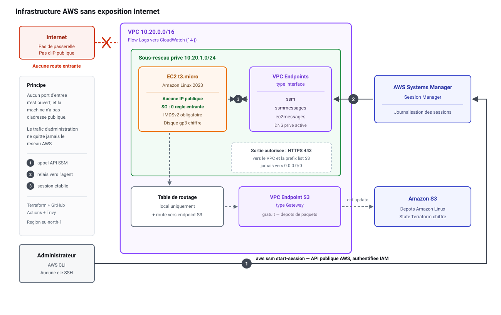
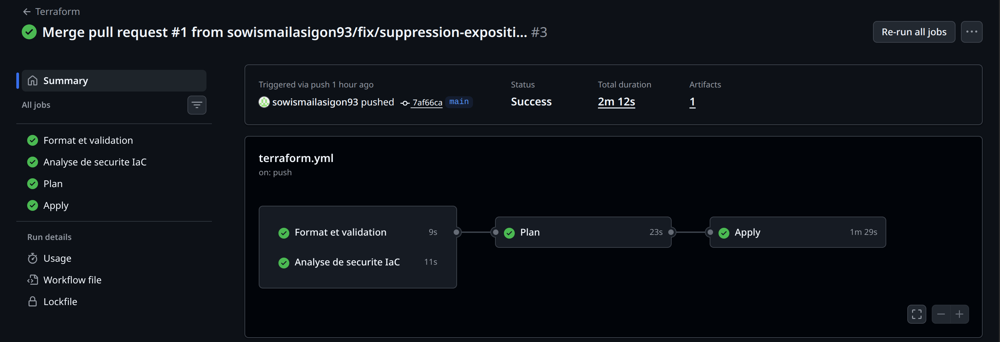
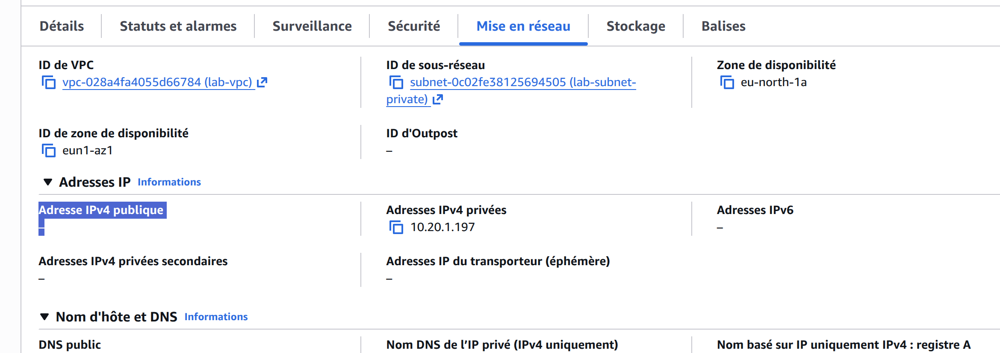
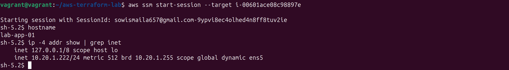

# Infrastructure AWS sécurisée — Terraform & GitHub Actions

> Déploiement automatisé d'une instance EC2 **sans adresse IP publique et sans aucun port d'entrée ouvert**, administrée via AWS Systems Manager Session Manager à travers des VPC endpoints privés. Chaîne de livraison avec analyse de sécurité IaC bloquante.

**Auteur :** Ismaila Sow — Ingénieur Systèmes & Sécurité
**Région :** eu-north-1 · **Terraform :** 1.10 · **Provider AWS :** ~> 5.0

---

## Objectif

Ce projet répond à une question simple : comment administrer un serveur en production sans jamais l'exposer à Internet, et comment garantir que cette propriété ne se dégrade pas au fil des modifications ?

La réponse tient en deux parties : une architecture réseau fermée, et un pipeline qui refuse toute modification réintroduisant une exposition.

---

## Architecture




| Composant | Choix | Raison |
|---|---|---|
| VPC | `10.20.0.0/16`, sous-réseau privé `/24` | Aucune passerelle Internet dans le VPC |
| Instance | EC2 `t3.micro`, Amazon Linux 2023 | Pas d'IP publique, non routable depuis Internet |
| Accès | SSM Session Manager | Ni port 22, ni clé SSH, ni bastion à maintenir |
| Endpoints | `ssm`, `ssmmessages`, `ec2messages` (interface) + `s3` (gateway) | L'agent SSM et les dépôts de paquets restent dans le réseau AWS |
| Groupe de sécurité | 0 règle entrante, sortie 443 vers le VPC et la prefix list S3 | Surface d'attaque réduite au strict nécessaire |
| État Terraform | S3 chiffré, versionné, verrouillé (`use_lockfile`) | Le state contient des données sensibles en clair |
| Journalisation | VPC Flow Logs vers CloudWatch, rétention 14 jours | Traçabilité des flux réseau |
| Métadonnées | IMDSv2 obligatoire, `hop_limit = 1` | Protège les credentials de l'instance contre une SSRF |
| Disque | gp3 chiffré | Chiffrement au repos |

---

## Le pipeline




| Étape | Rôle | Bloquant |
|---|---|---|
| `validate` | `terraform fmt -check` et `terraform validate` | Oui |
| `security` | Analyse IaC par Trivy, sévérités HIGH et CRITICAL | **Oui** |
| `plan` | Génère et publie le plan comme artefact | Oui |
| `apply` | Déploiement | Déclenchement manuel uniquement |

Sur chaque pull request, les trois premières étapes s'exécutent et le plan est publié pour relecture. Le déploiement n'intervient jamais automatiquement.

---

## Ce que l'analyse de sécurité a révélé

C'est la partie la plus instructive du projet.

La première version plaçait l'instance dans un sous-réseau avec `map_public_ip_on_launch = true`, derrière une passerelle Internet, et autorisait la sortie vers `0.0.0.0/0`. Aucun port d'entrée n'était ouvert, ce qui semblait suffisant.

Trivy a remonté trois alertes :

| Identifiant | Sévérité | Constat |
|---|---|---|
| `AWS-0164` | HIGH | Le sous-réseau attribue une adresse IP publique |
| `AWS-0104` ×2 | HIGH | Les règles de sortie autorisent tout Internet |


L'écart était réel : la machine disposait bien d'une adresse publique et restait joignable au niveau réseau, même avec tous les ports fermés. L'intention affichée et l'implémentation ne coïncidaient pas.

**Correction apportée** ([PR #1](../../pull/1)) :

- suppression de l'attribution d'IP publique et de la passerelle Internet ;
- ajout de trois VPC endpoints d'interface pour que l'agent SSM joigne les services AWS sans sortir du VPC ;
- ajout d'un VPC endpoint S3 de type gateway, gratuit, pour les dépôts de paquets d'Amazon Linux ;
- restriction de la sortie au CIDR du VPC et à la prefix list S3.

Les trois alertes ont disparu, et l'architecture correspond désormais à ce qu'elle prétend être.

---

## Vérification

```bash
# Aucune adresse IP publique
aws ec2 describe-instances --instance-ids $ID \
  --query 'Reservations[].Instances[].PublicIpAddress'
# → [ null ]

# Connexion sans SSH ni port ouvert
aws ssm start-session --target $ID
```




---

## Limites assumées

Ce projet est un laboratoire. Les écarts suivants sont connus et documentés plutôt que dissimulés.

**Authentification de la chaîne de livraison.** L'approche retenue initialement était OIDC, qui évite tout secret de longue durée dans la CI. Elle s'est révélée impossible sur ce compte : la SCP gérée par AWS pour les comptes « projects » interdit `iam:*Provider*`, dans le Free Tier comme dans le plan payant. Repli sur un utilisateur IAM dédié, clés stockées en secrets GitHub chiffrés, rotation prévue et suppression en fin de projet. Sur un compte standard, la politique de confiance serait restreinte à `repo:<compte>/<dépôt>:*`.

**Permissions de l'utilisateur CI.** `PowerUserAccess` et `IAMFullAccess` sont des raccourcis de laboratoire. En production, une politique sur mesure limitée aux ressources du projet s'impose.

**Approbation avant déploiement.** Les règles de protection d'environnement de GitHub ne sont pas disponibles sur un dépôt privé en compte gratuit. L'`apply` est donc restreint à un déclenchement manuel explicite, à rebasculer sur une approbation par relecteur le jour où le dépôt passe en public.

**Haute disponibilité.** Déploiement sur une seule zone de disponibilité, sans redondance. Hors périmètre pour un projet de démonstration.

**Coût.** Les trois endpoints d'interface coûtent environ 0,03 $ par heure. L'infrastructure est détruite après chaque session de travail.

---

## Reproduire

```bash
# Prérequis : Terraform >= 1.10, AWS CLI v2 configurée
git clone https://github.com/sowismailasigon93/aws-terraform-lab.git
cd aws-terraform-lab

# Adapter le nom du bucket de state dans providers.tf
terraform init
terraform plan
terraform apply

# Se connecter
aws ssm start-session --target $(terraform output -raw instance_id)

# Détruire
terraform destroy
```

---

## Suites possibles

- Rôle Ansible de durcissement CIS appliqué après provisionnement
- Supervision Prometheus et Grafana via `node_exporter`
- Politique IAM sur mesure en remplacement de `PowerUserAccess`
- Publication du plan en commentaire automatique de pull request
